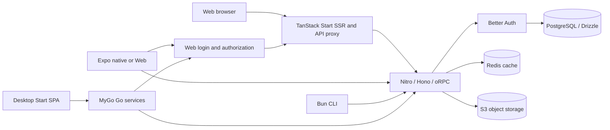

# Architecture

Voidmix separates transport adapters, reusable capabilities, and application-owned resources. It is a starter with one API deployment, not a collection of independently deployed backend services.

## Runtime topology

Web SSR calls the API directly through the internal `API_ORIGIN`. Browser requests use Web's same-origin `/api/auth/*` and `/api/rpc/*` proxies. The proxy preserves methods, bodies, cookies, origins, response cookies, request IDs, and redirects.

Expo and CLI use the API HTTP origin directly. Desktop authentication and credentialed remote operations belong to Go; the SPA calls local Go methods through generated IPC bindings. The installed desktop application serves `dist/client` and runs no JavaScript SSR server. Start's server build exists to generate the SPA shell.

## Workspace responsibilities

| Owner                        | Public seam                                 | Owns                                                                               | Does not own                                         |
| ---------------------------- | ------------------------------------------- | ---------------------------------------------------------------------------------- | ---------------------------------------------------- |
| `apps/api`                   | HTTP endpoints                              | Environment configuration, auth instance, pools, lazy clients, middleware ordering | Browser UI or shared contract definitions            |
| `apps/web`                   | SSR pages and same-origin proxies           | Web routing, user interaction, per-request credential forwarding                   | Database or infrastructure clients                   |
| `apps/desktop`               | Generated Go IPC                            | Windows, keyring credentials, native lifecycle, static SPA                         | A deployed JavaScript server                         |
| `apps/mobile`                | Native screens                              | SecureStore, browser authorization, device lifecycle                               | Server credentials or database access                |
| `apps/cli`                   | Commands, JSON, exit codes                  | Argument validation, origins, deadlines                                            | Long-running development servers                     |
| `packages/api`               | `/contract`, `/client`                      | Zod schemas and typed HTTP transport                                               | Procedure implementations or server configuration    |
| `packages/auth`              | `/server`, `/client`, `/device`, `/types`   | Auth construction and device grant protocol                                        | Process environment or native credential storage     |
| `packages/db`                | `/client`, `/schema`, `/migrate`            | Pool factory, schema, SQL history                                                  | Application singleton ownership                      |
| `packages/cache`             | `/client`, `/json`                          | Redis defaults and explicit-TTL JSON helpers                                       | Environment loading or business fallback policy      |
| `packages/storage`           | `/client`                                   | Validated, prefix-scoped S3 handles                                                | Bucket lifecycle policy or application configuration |
| `packages/logger`            | Root export, `/hono`, `/orpc`, `/otlp`      | Consistent event configuration, redaction, adapters                                | Business payload selection                           |
| `packages/ui`                | Component, utility, and stylesheet subpaths | Base UI components, Hugeicons, theme                                               | App routing or business state                        |
| `packages/scripts`           | Repository commands                         | Tooling, safe process execution, structural validation                             | Deployed business behavior                           |
| `packages/typescript-config` | JSON configurations                         | Shared compiler defaults                                                           | Runtime code                                         |

Applications may depend on shared packages. Shared packages do not depend on applications. Production imports cross workspaces through declared public exports. Integration tests may import a real application adapter to verify its behavior. Runtime package dependencies must remain acyclic.

`bun run check:workspace` checks these rules and verifies that each workspace has a README. It also rejects undeclared dependencies and direct server capability imports in browser-facing source. Web's `src/server` and API route adapters are explicit server locations; TanStack's server-only guard and application builds provide additional enforcement.

## API request and resource lifecycle

1. Hono assigns a validated request ID and starts one evlog event for every request.
2. The error handler preserves intentional HTTP exceptions and hides unexpected error details.
3. `/health` provides liveness without opening backend connections; `/ready` reports readiness from a bounded PostgreSQL query and the optional cache's state.
4. API CORS middleware handles browser access; Better Auth owns `/api/auth/*`.
5. RPC session middleware resolves Cookie or Bearer credentials once.
6. Each application's RPC handler passes headers, session, logger, and injected `ApiServices` through `RpcContext`. oRPC validates the shared contract and enriches the existing event with the operation name. `requireSession` protects selected procedures.

The API separates configuration, resource ownership, and HTTP assembly:

| Module                  | Interface and responsibility                                                                                                                                              |
| ----------------------- | ------------------------------------------------------------------------------------------------------------------------------------------------------------------------- |
| `src/config.ts`         | `loadApiConfig(env)` produces a configuration snapshot without reading process globals.                                                                                   |
| `src/resources.ts`      | `createApiResources(config)` owns one lazy PostgreSQL pool, auth instance, optional Redis/S3 handles, and shutdown; exposes `database`, `getCache()`, and `getStorage()`. |
| `src/app.ts`            | `createApp({ auth, services, corsOrigins, logger, rpcRouter? })` assembles HTTP behavior without constructing infrastructure.                                             |
| `src/lib/context.ts`    | `ApiServices` describes borrowed backend capabilities; `RpcContext` carries them in `services` alongside request state.                                                   |
| `src/middleware/rpc.ts` | `createRpcMiddleware(services, router?)` creates one handler per application, defaulting to the public router.                                                            |

`src/runtime.ts` is the process composition root: it reads the environment, initializes logging with an optional OTLP drain, and creates the resource owner. Only `server.ts` and Nitro lifecycle plugins import it; `check:workspace` enforces this direct-import rule. Routes and middleware receive narrow capabilities. Adding a new dependency means wiring it through the factory rather than importing a hidden singleton.

`server.ts` passes the resource owner as `services` to `createApp`; procedures access `context.services.database`, `await context.services.getCache()`, and `context.services.getStorage()`. The database getter reuses the owner's Drizzle handle without opening a connection. Redis shares one connection attempt per resource owner and clears failed initialization so later calls can retry. S3 creates one lazy handle per owner. Optional capabilities return `null` when disabled. Shared library factories never read application configuration. Enabled S3 requires complete connection settings at startup; neither construction nor builds contact its backend.

`src/plugins/resources.ts` delegates to the owner's `close()` when Nitro closes, after request processing stops, and then flushes the log drain. Shutdown is shared and idempotent, rejects new resource acquisition, attempts every cleanup, and reports failures after all settle. Reading `database`, calling `getStorage()`, or awaiting `getCache()` fails once closing begins, including after it completes. Already borrowed handles are not revoked; their operations follow the underlying client's shutdown behavior. Pass the owner itself rather than copying its database getter into a value. Add each new process-owned resource and its cleanup together in `src/resources.ts`. Avoid opening pools per request or at shared-package import time.

HTTP tests instantiate the same `createApp` with an in-memory auth adapter and fake services, exercising middleware order, authorization, validation, errors, and instance isolation without backend services. The optional `rpcRouter` lets tests inspect procedure context without extending the public contract. Shared logger tests stay inside their package; application request IDs and response policy belong to API tests. Standalone evlog configuration remains process-wide, so configuring multiple log services in one process is not an isolation guarantee.

## Authentication and credentials

The API uses Better Auth with PostgreSQL/Drizzle, email/password authentication, device authorization, and Bearer sessions. `BETTER_AUTH_URL` is the public **Web** origin because `/login` and `/authorize` are Web pages. `API_ORIGIN` is the server-to-server API origin; native clients have separate public API origins.

Web uses HttpOnly session cookies. SSR supplies Cookie and Authorization through a getter evaluated for the current request; a module-level client must never retain a user's headers.

Native clients request a device grant and display the public user code. The user signs in on the Web page, checks the code, and approves or denies. Only the requesting application redeems the private device code. Redirect URLs contain no token. Device sessions and the authorization browser's cookie session are independent.

| Client      | Authorization surface                                                         | Credential owner                              |
| ----------- | ----------------------------------------------------------------------------- | --------------------------------------------- |
| Expo native | System authorization browser and validated `voidmix://auth/complete` callback | SecureStore, isolated by API origin           |
| Expo Web    | Popup with opener removed; the parent polls                                   | Memory only                                   |
| MyGo        | Separate untrusted WebView without native bindings                            | Go and the OS keyring, isolated by API origin |

Cancellation, expiration, denial, polling limits, and failed credential persistence are part of the protocol. Revoke a redeemed session if it cannot be committed locally. Sign-out revokes the server session before removing the stored credential.

## Build and maintenance decisions

Shared packages export TypeScript source and are compiled by consumers. This avoids a separate watch/build graph for small libraries. Public subpaths separate server and browser entry points, especially in the auth package; avoid root exports that accidentally aggregate both.

Web and desktop share the UI package but have different rendering models. Web is SSR. Desktop prerenders an HTML shell, then mounts the route tree through `ClientOnly` after hydration. It embeds only static assets into MyGo. Mobile shares protocols and contracts rather than DOM components.

The repository retains Bun test for backend utilities and tooling, Playwright for production HTTP/browser/CLI flows, and Go tests for native auth. See [testing](testing.md) for the reasoning and coverage limits.

Deployment has two targets built from the same Dockerfile images: `compose.deploy.yaml` bundles PostgreSQL, Redis, and S3 on one host, and `infra/k8s` describes Web and API for a cluster with managed data services. Both apply migrations before the API serves; `migrateDatabase` serializes concurrent runs with a PostgreSQL advisory lock. See the [decision log](decisions.md) for the reasoning behind these and other constraints.

The root README is the entry point. Workspace READMEs describe local interfaces and workflows. `AGENTS.md` provides concise, scoped editing constraints. Keep comments near invariants that are easy to break; keep long setup explanations in documentation.
